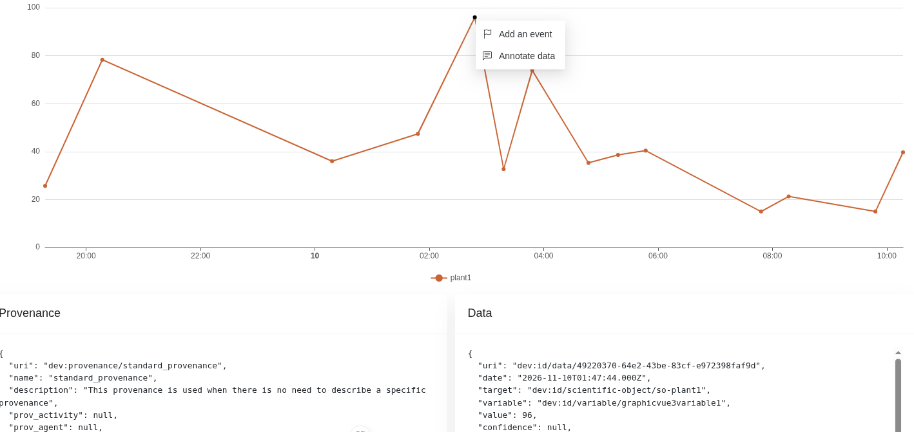
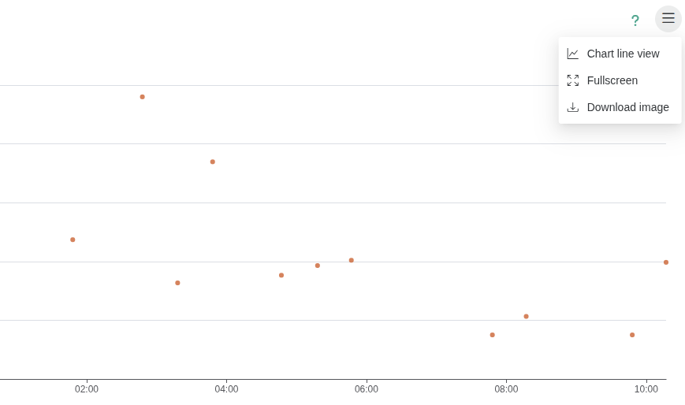

# HELP

**Data contextual menu**
- Click on a data point or event flag to see information.
- Right click on a data point to see the contextual menu: add an event or annotate the data.
- Click on an image pin ("I", red when the image is annotated) to display the image above the graphic.

**Zoom**
- Click and drag horizontally on the graphic, over the period you want to zoom on: the graphic then only displays this period.
- Use the mouse wheel to zoom in and out.
- Click on "Reset zoom" to display the whole period again.

**Contextual menu**
- A graphical contextual menu (☰) allows to:
    - choose a chart line (by default) or a scatter plot view.
    - a fullscreen mode.
    - download an image from the charts.

