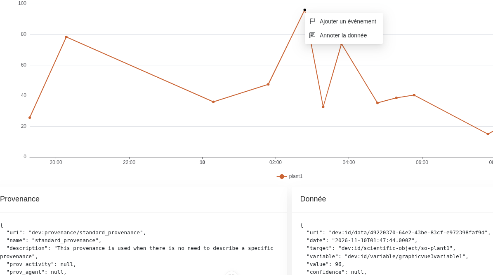
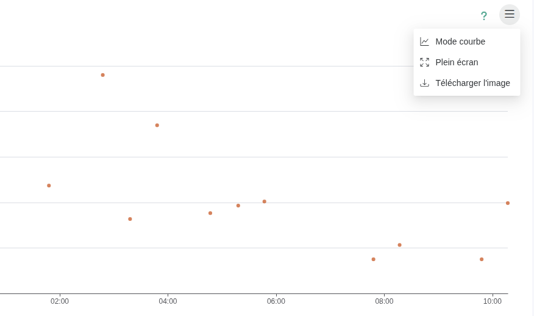

# AIDE

**Menu contextuel de donnée**
- Faire un clic sur un point ou sur un événement pour voir les informations associées.
- Faire un clic droit sur le point de la donnée pour voir le menu contextuel : ajouter un événement ou annoter la donnée.
- Faire un clic sur l'épingle d'une image (« I », rouge quand l'image est annotée) pour afficher l'image au-dessus du graphique.

**Zoom**
- Cliquer et faire glisser horizontalement sur le graphique, au-dessus de la période sur laquelle zoomer : le graphique n'affiche alors plus que cette période.
- Utiliser la molette de la souris pour zoomer et dézoomer.
- Cliquer sur « Réinitialiser le zoom » pour afficher de nouveau toute la période.

**Menu contextuel**
- Un menu contextuel (☰) de la représentation graphique permet de :
    - choisir le mode courbe (par défaut) ou nuage de points.
    - d'afficher en plein écran.
    - de télécharger une image.

